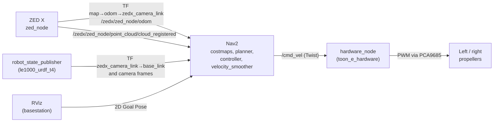

# toon_e

Bringup package for the Loon-E autonomous surface vessel. One launch file starts:

- the **ZED X** wrapper, for localization (visual-inertial odometry) and a point cloud of obstacles,
- **robot_state_publisher**, with the boat description from `le1000_urdf_t4` ([src/loone_urdf](../loone_urdf)),
- **Nav2**, which plans a path to a goal and publishes velocity commands,
- **`hardware_node`** from [toon_e_hardware](../toon_e_hardware), which turns those commands into propeller throttles.

**Status.** Localization is ZED VIO only, because there is no GPS yet. Goals are sent from RViz,
and there is no mission node yet. See [Roadmap: GPS waypoints](#roadmap-gps-waypoints).

| Section | Covers |
|---------|--------|
| [How it fits together](#how-it-fits-together) | Data flow and the TF tree |
| [Launch files](#launch-files) | What each one starts, and its arguments |
| [Configuration](#configuration) | Config files, ZED overrides, Nav2 setup |
| [Build](#build) / [Run](#run) | Commands |
| [First run on the boat](#first-run-on-the-boat) | Bring-up checklist, in order |
| [Tuning](#tuning) | Symptom → parameter |
| [Measurements still needed](#measurements-still-needed) | Values that are estimates today |
| [Known limitations](#known-limitations) | What this setup does not handle |
| [Coming from Loon-E](#coming-from-loon-e) | What changed from the old repo |

## How it fits together



### TF tree

```
map                         ZED wrapper (publish_map_tf)
└── odom                    ZED wrapper (publish_tf)
    └── zedx_camera_link    URDF root
        ├── zedx_camera_center → left/right camera and optical frames
        └── base_link       URDF joint cam_1_to_base_link
            ├── prop_l_link, prop_r_link, rudder_l_link, rudder_r_link
            ├── gps_link
            └── cam_2_link  placeholder for a planned second camera
```

The tree is inverted on purpose. This ZED wrapper has no `base_frame` parameter, so it can
only track `zedx_camera_link`, and a TF frame can have only one parent. That puts
`base_link` below the camera. Nav2 only needs `map → base_link` to resolve, and it does.

Every transform must have exactly one publisher. Two rules follow:

- Don't add a `static_transform_publisher` between the camera and `base_link`. The URDF
  joint already provides that transform.
- Don't let the ZED wrapper publish its own URDF. `zed_launch.py` passes `publish_urdf:=false`.

Both used to happen, and TF flipped between two different values.

## Launch files

| File | Starts |
|------|--------|
| `launch.py` | Everything: `zed_launch.py`, robot_state_publisher, `hardware_node` and Nav2 |
| `zed_launch.py` | Only the ZED wrapper, with the toon_e overrides |
| `rviz_launch.py` | RViz with Nav2's `nav2_default_view.rviz`: costmaps, paths, footprint and the 2D Goal Pose tool. Run it on the basestation |

`launch.py` arguments (`zed_launch.py` takes the camera ones, `use_sim_time` and `enable_gnss`):

| Argument | Default | Meaning |
|----------|---------|---------|
| `camera_name` | `zedx` | ZED namespace and frame prefix (`zedx_camera_link`) |
| `camera_model` | `zedx` | ZED camera model passed to the wrapper |
| `zed_node_name` | `zed_node` | ZED node name inside the namespace |
| `use_sim_time` | `false` | Use `/clock`. Keep `false` on the boat |
| `sim` | `false` | `true` skips `hardware_node` (Isaac Sim drives the actuators) |
| `nav` | `true` | `false` skips Nav2. Use it for teleop, so only one node publishes `/cmd_vel` |
| `enable_gnss` | `false` | Fuse `/navsatfix` into the ZED pose. Leave `false` until a GPS publishes |

If you change `camera_name` or `zed_node_name`, also update every `/zedx/zed_node/...` topic in
`config/nav2_params.yaml`.

## Configuration

| File | Read by | Contents |
|------|---------|----------|
| `config/config.yaml` | `hardware_node` | PWM ranges, `cmd_vel` scaling, battery thresholds. Parameter reference: [toon_e_hardware README](../toon_e_hardware/README.md#parameters) |
| `config/nav2_params.yaml` | Nav2 | Every Nav2 server and both costmaps |
| `config/model.yaml` | ZED wrapper | Classes of the custom YOLO model (buoys, cardinal markers, otter) |
| `config/task1_waypoints.json` | Nothing yet | Task 1 GPS course, for the future waypoint mission |
| `toon_e/model/loone.onnx` | ZED wrapper | Object detection model, installed to `share/toon_e/model/` |

### ZED settings changed by toon_e

`zed_launch.py` changes a few ZED settings at launch time, so the zedx submodule's YAML files
stay untouched. The wrapper applies launch arguments and `param_overrides` after every YAML
file, so these values win.

| Setting | Value | Why |
|---------|-------|-----|
| `publish_urdf` | `false` | robot_state_publisher in `launch.py` publishes the description |
| `publish_tf`, `publish_map_tf` | `true`, `true` | The ZED owns `odom → camera` and `map → odom` |
| `enable_gnss` | `false` | This launch argument overrides `gnss_fusion.gnss_fusion_enabled: true` in `common_stereo.yaml`. Nothing publishes `/navsatfix` yet |
| `object_detection.custom_onnx_file` | Absolute path to the installed `loone.onnx` | The ZED SDK doesn't resolve relative paths |
| `debug.disable_nitros` | `true` | Keeps the `image/compressed` topics that the basestation camera feed uses |
| `pos_tracking.reset_odom_with_loop_closure` | `false` | Otherwise `odom` jumps on every loop closure, which breaks Nav2's local costmap and controller. Loop-closure corrections still go into `map → odom` |
| `depth.voxel_point_cloud` | `true` | ~100 mm voxels instead of the full cloud (~9 MB per frame), so two costmaps can subscribe without flooding DDS on the Jetson |

To change another ZED setting without editing the submodule, add it to the `param_overrides`
list in `zed_launch.py`.

### Nav2 setup

- **No map server or AMCL.** The ZED provides `map → odom`.
- **Planner:** NavFn (A\*). `allow_unknown: true`, because open water is mostly unknown cells.
- **Controller:** Regulated Pure Pursuit. With rotate-to-heading on, the boat pivots toward the
  path first (differential thrust allows it). Paths are never followed in reverse; only the
  BackUp recovery reverses.
- **Recoveries:** spin, backup and wait. Nav2's default behaviour tree needs all three.
- **Global costmap:** 50 × 50 m rolling window in `map`, 0.1 m cells.
- **Local costmap:** 10 × 10 m rolling window in `odom`, 0.1 m cells.
- **Footprint:** a 1.10 × 0.64 m rectangle, from the URDF's 1.0 × 0.6 m hull plus padding.
- **Output:** velocity_smoother publishes `geometry_msgs/Twist` on `/cmd_vel` (plain Twist on
  Humble), which `hardware_node` subscribes to directly.

**Obstacle height filter.** Both costmaps mark cells from the ZED point cloud, keeping only
points between `min_obstacle_height` and `max_obstacle_height`. Those heights are z in
`odom`/`map`. The ZED starts tracking with the camera at z = 0, and the camera is about 0.50 m
above the water, so the water surface sits near z = −0.50. `min_obstacle_height: -0.35` drops
anything less than about 15 cm above the water.

Don't enable the ZED's `pos_tracking.two_d_mode`. It zeroes roll and pitch, so on waves the
cloud would be transformed at the wrong angle and the water would show up as obstacles.

**Units.** Nav2 works in m/s and rad/s. `hardware_node` converts them using `max_linear_speed`
and `max_angular_speed` from `config.yaml`. Both stay at 1.0 until calibrated, which makes Nav2's
numbers raw throttle fractions (0.5 m/s means half throttle). Calibrate first; see step 3 of
[First run on the boat](#first-run-on-the-boat).

## Build

On the Jetson (ROS 2 Humble, with the ZED SDK and ZED X driver installed), from the workspace root:

```bash
git submodule update --init --recursive
pip3 install -r src/toon_e_hardware/requirements.txt
rosdep install --from-paths src --ignore-src -y
colcon build --symlink-install
source install/setup.bash
```

**On a PC without the matching CUDA.** `zed_components` (the ZED node, in C++) only compiles
against the CUDA version the installed ZED SDK was built for. You can still build everything
else, which is enough to check the URDF and the launch files:

```bash
colcon build --packages-up-to toon_e --packages-ignore zed_components zed_debug
```

## Run

On the boat:

```bash
tools/start.sh                              # checks the camera daemons, then runs launch.py
ros2 launch toon_e launch.py                # or run the launch file directly
ros2 launch toon_e launch.py nav:=false     # camera and hardware only, for teleop
```

On the basestation, run `ros2 launch toon_e rviz_launch.py`, then send a goal with **2D Goal Pose**.
From the command line:

```bash
ros2 action send_goal /navigate_to_pose nav2_msgs/action/NavigateToPose \
  "{pose: {header: {frame_id: map}, pose: {position: {x: 5.0, y: 0.0}, orientation: {w: 1.0}}}}"
```

Goals are in the `map` frame. Its origin is where the camera was when the ZED started
tracking, with x forward and y to the left.

**Middleware.** The boat and the basestation must use the same `RMW_IMPLEMENTATION` and
`ROS_DOMAIN_ID`. With `rmw_zenoh_cpp`, a router has to be running
(`ros2 run rmw_zenoh_cpp rmw_zenohd`), or nodes won't find each other.

## First run on the boat

Do these in order; each step relies on the ones before it.

1. **Camera and TF.** Run `ros2 launch toon_e launch.py nav:=false`, then check:
   - `ros2 node list` shows exactly one robot_state_publisher.
   - `ros2 run tf2_tools view_frames` gives the tree [above](#tf-tree), with only one parent for `base_link`.
   - `ros2 run tf2_ros tf2_echo map base_link` stays steady while the boat is still.
   - `ros2 topic hz /zedx/zed_node/odom` and `ros2 topic hz /zedx/zed_node/point_cloud/cloud_registered` both report a rate.
2. **Direction.** Still with `nav:=false`, drive with
   `ros2 run teleop_twist_keyboard teleop_twist_keyboard`. Forward must increase x in
   `tf2_echo map base_link`, and turning left must increase yaw. If either is wrong, check
   [CALIBRATION.md §2](../toon_e_hardware/wiki/CALIBRATION.md#2-propeller-direction) or the camera mount in the URDF.
3. **Calibrate speeds.** Follow [CALIBRATION.md §3–4](../toon_e_hardware/wiki/CALIBRATION.md#3-max_linear_speed)
   and write `max_linear_speed` and `max_angular_speed` into `config/config.yaml`. Keep Nav2's
   `desired_linear_vel` and the velocity_smoother `max_velocity` below the calibrated values.
4. **Costmaps.** Start the full launch and open RViz. Open water should be free, and a buoy or
   the dock should show as lethal. If water shows up as obstacles, see [Tuning](#tuning).
5. **First goal.** Send a goal 5–10 m ahead in clear water. The boat should plan, drive, and
   stop within 0.5 m (`xy_goal_tolerance`).

## Tuning

All parameters below are in `config/nav2_params.yaml` unless stated otherwise. Costmap values
appear twice, once for each costmap.

| Symptom | Parameter | Change |
|---------|-----------|--------|
| Water marked as obstacles | `zed_cloud.min_obstacle_height` | Raise it (less negative). Also try lowering the ZED's `depth.depth_confidence` (currently 95; lower is stricter) through `param_overrides` |
| Water shows up late in long runs | `zed_cloud.min_obstacle_height` | VIO height drift moves the water plane; widen the margin |
| Low buoys missed | `zed_cloud.min_obstacle_height` | Lower it, but keep it above the water |
| Boat never "arrives" | `general_goal_checker.xy_goal_tolerance`, `yaw_goal_tolerance` | Raise them |
| Weaves or overshoots the path | `FollowPath.desired_linear_vel`, `lookahead_dist` | Lower the speed or lengthen the lookahead |
| Pivots in place too often | `FollowPath.rotate_to_heading_min_angle` | Raise it, or set `use_rotate_to_heading: false` |
| "Goal is off the global costmap" | `global_costmap.width`, `height` | Goals must be within half the window (25 m); grow the window |
| Passes too close to obstacles | `inflation_layer.inflation_radius` | Raise it (now 1.0 m) |

## Measurements still needed

The shipped values are estimates. Measure these and update them:

| What | Where |
|------|-------|
| ZED X mount relative to the boat centre | `cam_x`, `cam_y`, `cam_top_z` in [loone_asv.urdf.xacro](../loone_urdf/urdf/loone_asv.urdf.xacro) |
| Camera height above the waterline | `min_obstacle_height` in `nav2_params.yaml` (both costmaps) |
| Hull outline | `footprint` in `nav2_params.yaml` (both costmaps) |
| Top speed and turn rate | `max_linear_speed`, `max_angular_speed` in `config/config.yaml` |

## Known limitations

- **Position drifts.** Without GPS, `map` is wherever the boat started, and VIO drift builds up
  over a run. The ZED's area memory corrects some of it when the boat revisits a place (loop closure).
- **Stale obstacles on open water.** A costmap clears a cell only when a ray passes through it to
  a return farther away. On open water there is often nothing farther away, so cells marked by
  something that has moved (another boat) can linger. Nav2's default behaviour tree clears the
  costmaps during recovery. To clear them by hand:
  `ros2 service call /global_costmap/clear_entirely_global_costmap nav2_msgs/srv/ClearEntireCostmap`
  (and the same for `/local_costmap/clear_entirely_local_costmap`).
- **Detections aren't used for planning.** The ZED's object detector publishes buoys and markers
  on `/zedx/zed_node/obj_det/objects`, but Nav2 sees them only as points in the cloud.
- **No software e-stop.** `hardware_node` does not block `/cmd_vel` while the e-stop is pressed;
  the RC e-stop cuts thruster power in hardware. `hardware_node` does stop the props if
  `/cmd_vel` goes quiet for 0.5 s.
- **Humble only.** `nav2_params.yaml` uses Humble parameter names. Jazzy renamed several of them
  (in `behavior_server`, for example) and publishes `TwistStamped` on `/cmd_vel`.

## Roadmap: GPS waypoints

1. Choose a receiver and publish its fixes as `sensor_msgs/NavSatFix` on `/navsatfix`, with
   `frame_id: gps_link`. The stub for this is `gps.py` in toon_e_hardware.
2. In the URDF, add a fixed joint `gps_link → zedx_gnss_link`. The ZED's GNSS fusion reads the
   antenna offset from the `zedx_gnss_link → zedx_camera_link` transform.
3. Launch with `enable_gnss:=true`. The `map` frame then lines up with GPS, and the ZED offers
   `/zedx/zed_node/fromLL` and `/zedx/zed_node/toLL`, which use robot_localization's service types.
4. Write a mission node. It converts each point in `config/task1_waypoints.json` with `fromLL`
   and sends them to Nav2's `FollowWaypoints` action.
5. Grow the global costmap. Task 1 legs are 54–71 m long, so a rolling window needs to be at
   least ~150 m across.

## Coming from Loon-E

| Old | Now |
|-----|-----|
| `ros2 launch loone launch.py` | `ros2 launch toon_e launch.py` |
| `slam_launch.py`: SLAM Toolbox on a laser scan made from ZED depth | Removed. The ZED owns `map → odom`; scan matching has few features to lock onto on open water |
| `depthimage_to_laserscan` for obstacles | The ZED point cloud, filtered by height |
| `navsat_transform` for lat/lon conversion | Removed. The ZED's `fromLL`/`toLL` services do this once GNSS is on |
| `static_tf_cam_to_base` in `launch.py` | Removed. The URDF joint `cam_1_to_base_link` is the only publisher |
| `test_launch.py` | Removed. It ran a `hardware_test` executable that no package provides |

## Tests

```bash
colcon test --packages-select toon_e
colcon test-result --verbose
```

These are lint checks only (flake8, pep257, copyright). flake8 and pep257 pass. The copyright
check fails because no `.py` file in the package has a copyright notice; toon_e_hardware is the same.
